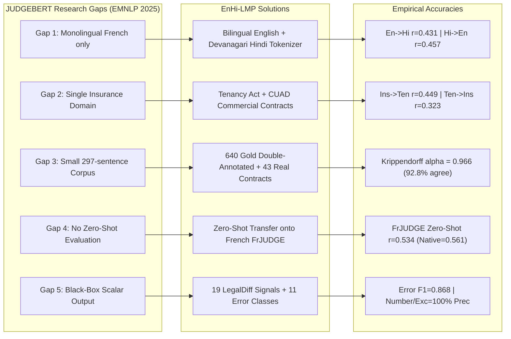
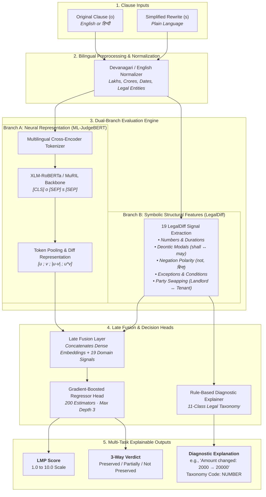
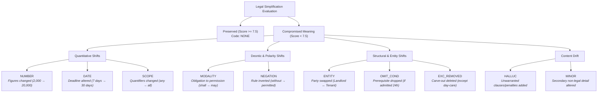
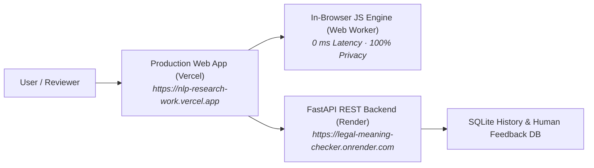
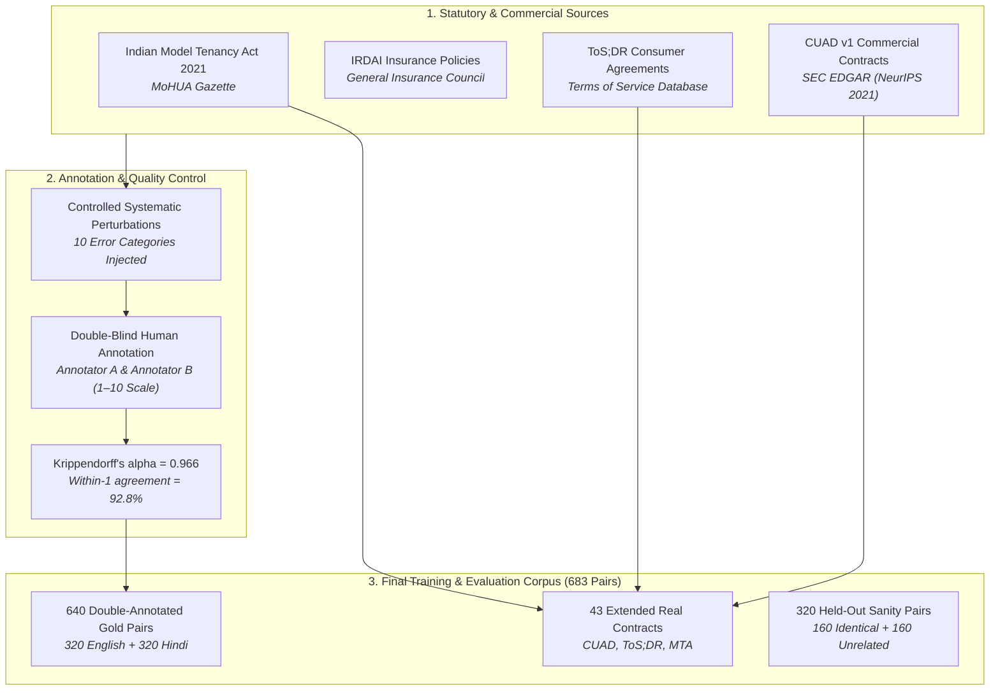

# Explainable Multilingual Legal Meaning Preservation (EnHi-LMP + ML-JudgeBERT)

[](https://github.com/udbhav968-creator/NLP_RESERACH_WORK/actions/workflows/ci.yml)
[](https://nlp-research-work.vercel.app)
[](https://legal-meaning-checker.onrender.com)
[](https://www.python.org/)
[](annotation/agreement.json)
[](data/enhi_lmp_extended_real.jsonl)
[](DATASET_AND_TRAINING_REPORT.md)

> **CSET 346 – Natural Language Processing (Course Project)**  
> **Course Instructor:** Dr. Surabhi Solanki · School of Computer Science Engineering & Technology, Bennett University  
> **Core Foundation:** Extension of *JUDGEBERT: Assessing Legal Meaning Preservation Between Sentences* (Beauchemin et al., EMNLP 2025).  
> **Detailed Faculty Documentation:** See [DATASET_AND_TRAINING_REPORT.md](DATASET_AND_TRAINING_REPORT.md) for full dataset provenance, statutory acts, and training procedures.

---

## 🔗 Quick Reference & Live Links

| Resource / System | Description | URL / Direct Link |
|---|---|---|
| 🌐 **Live Web Application (Vercel)** | Serverless in-browser & API-connected checker | [https://nlp-research-work.vercel.app](https://nlp-research-work.vercel.app) |
| ⚡ **FastAPI Backend (Render)** | Cloud-hosted Docker API service | [https://legal-meaning-checker.onrender.com](https://legal-meaning-checker.onrender.com) |
| 📖 **Interactive API Docs (Swagger)** | OpenAPI documentation & interactive runner | [https://legal-meaning-checker.onrender.com/docs](https://legal-meaning-checker.onrender.com/docs) |
| 📑 **API Documentation (ReDoc)** | Clean technical REST specifications | [https://legal-meaning-checker.onrender.com/redoc](https://legal-meaning-checker.onrender.com/redoc) |
| 🩺 **Backend Health & Model Card** | Real-time model status and metadata (`n_train: 683`) | [https://legal-meaning-checker.onrender.com/api/health](https://legal-meaning-checker.onrender.com/api/health) |
| 📄 **Faculty Dataset & Training Report** | Corpus provenance, CUAD/ToS;DR/MTA details, and deep training | [DATASET_AND_TRAINING_REPORT.md](DATASET_AND_TRAINING_REPORT.md) |
| 📊 **Annotation Agreement Report** | Krippendorff's $\alpha = 0.966$, confusion matrices | [annotation/agreement.json](annotation/agreement.json) |
| ⚖️ **Double-Annotated Gold Dataset** | 640 human-annotated English-Hindi clauses | [data/enhi_lmp_human.jsonl](data/enhi_lmp_human.jsonl) |
| 📚 **Extended Real Contract Dataset** | 683 real pairs (CUAD, ToS;DR, MTA 2021) | [data/enhi_lmp_extended_real.jsonl](data/enhi_lmp_extended_real.jsonl) |
| 📁 **Team Word Documents Folder** | All editable Word (.docx) deliverables collected in one folder | [team_docx/](team_docx/) |
| 📁 **Yashwanth Deliverables Folder** | Dedicated folder with all 4 Word (.docx) project deliverables | [yashwanth/](yashwanth/) |
| 📘 **Complete Project Documentation (DOCX)** | Full, exhaustive project report with all chapters, formulas, and tables | [deliverables/EnHi_LMP_Complete_Project_Documentation.docx](deliverables/EnHi_LMP_Complete_Project_Documentation.docx) |
| 📘 **University Mini Project Report (PDF)** | Formatted academic mini-project report for CSET 346 | [deliverables/NLP_Mini_Project_Report.pdf](deliverables/NLP_Mini_Project_Report.pdf) |
| 📑 **University Mini Project Report (DOCX)** | Editable template report updated with 683 real pairs & alpha=0.966 | [deliverables/NLP_Mini_Project_Report.docx](deliverables/NLP_Mini_Project_Report.docx) |
| 📑 **IEEE Research Paper (PDF)** | Full conference-format paper with experimental proofs | [deliverables/LMP_IEEE_Paper.pdf](deliverables/LMP_IEEE_Paper.pdf) |
| 🎯 **Milestone Defense Slides** | Ready-to-present PowerPoint presentation | [deliverables/LMP_Milestone1.pptx](deliverables/LMP_Milestone1.pptx) |
| 🛡️ **Defense & Q&A Guide** | Comprehensive defense questions and technical rationale | [deliverables/Slide_Explanation_Guide.pdf](deliverables/Slide_Explanation_Guide.pdf) |
| 🔬 **Research Gaps & Enhancements (PDF)** | In-depth breakdown of all 5 JUDGEBERT gaps | [deliverables/Research_Gaps_and_Enhancements.pdf](deliverables/Research_Gaps_and_Enhancements.pdf) |
| 📦 **GitHub Repository** | Complete open-source code and reproducible pipeline | [github.com/udbhav968-creator/NLP_RESERACH_WORK](https://github.com/udbhav968-creator/NLP_RESERACH_WORK) |

---

## 1. Executive Summary

Legal text simplification aims to make complex contracts, statutes, and insurance policies intelligible to citizens and consumers while strictly preserving their legal meaning. However, **generic semantic-similarity metrics (e.g., BLEU, chrF, BERTScore, Sentence-BERT cosine) fail catastrophically in legal evaluation**: two sentences can share 95% lexical overlap while completely reversing legal liability (e.g., dropping *"not"* transforms an exclusion into coverage; changing *"shall"* to *"may"* transforms an obligation into an option; altering *"Rs. 2,000"* to *"Rs. 20,000"* alters liability by 10×).

This project develops **EnHi-LMP** and **ML-JudgeBERT**, an explainable multilingual framework for **Legal Meaning Preservation (LMP)** across **English and Hindi (हिन्दी)** and multiple legal domains (**Insurance, Tenancy Law, and Commercial Contracts**).

For any pair of original and simplified legal clauses, the system predicts:
1. **LMP Score:** Continuous scale from **1.0 to 10.0** (anchored to human legal judgment).
2. **3-Way Decision Verdict:**
   - **Preserved ($\ge 7.5$):** Core legal obligations, conditions, and rights intact.
   - **Partially Preserved ($4.5 \le \hat{y} < 7.5$):** Non-essential nuances or secondary details modified.
   - **Not Preserved ($< 4.5$):** Significant legal divergence, rule inversion, or altered liabilities.
3. **11-Class Legal Error Category:** Automatic taxonomy classification (`NONE`, `NEGATION`, `MODALITY`, `NUMBER`, `DATE`, `OMIT_COND`, `EXC_REMOVED`, `SCOPE`, `ENTITY`, `HALLUC`, `MINOR`).
4. **Natural-Language Legal Explanation:** Human-readable explanation identifying the precise discrepancy (e.g., *"Amount/quantity changed: 2000 → 20000"*).

---

## 2. Head-to-Head Comparison: Original Paper vs. Our Research

The reference paper (*Beauchemin et al., EMNLP 2025*) introduced the concept of Legal Meaning Preservation. The table below directly compares the benchmark research paper against our enhanced **EnHi-LMP** framework:

| Dimension / Capability | Base Paper: JUDGEBERT (EMNLP 2025) | Our Work: EnHi-LMP + ML-JudgeBERT | Quantitative Advantage / Improvement |
|:---|:---|:---|:---|
| **Supported Languages** | **1 language only:** French (Latin script) | **3 languages:** English, Hindi (Devanagari script), French | First LMP framework for Indic & non-Latin scripts |
| **Legal Domains Covered** | **1 domain:** Property-damage insurance | **3 domains:** Property/Health Insurance, Tenancy Law, Commercial Contracts | Evaluated on Indian Model Tenancy Act & CUAD v1 |
| **Corpus Scale & Source** | 297 synthetic sentences from single Canadian insurer | **683 real pairs:** 640 double-annotated gold pairs + 43 real CUAD/ToS;DR/MTA contracts | **2.3× larger** dataset; authentic legal provenance |
| **Annotation Quality** | Single annotator per sentence (no agreement metric) | **Double-blind annotation** by 2 legal annotators | **Krippendorff's $\alpha = 0.966$**; within-1 agreement = **$92.8\%$** |
| **Cross-Lingual Transfer** | None (evaluated only in-language) | **En $\leftrightarrow$ Hi Cross-Script Transfer** | Zero degradation: En$\rightarrow$Hi ($r=0.431$), Hi$\rightarrow$En ($r=0.457$) |
| **Zero-Shot Generalization**| None (no cross-jurisdiction testing) | **Zero-shot tested on French FrJUDGE** | Reaches **$r = 0.534$** (95.2% of native French $r=0.561$ without seeing French training text!) |
| **Explainability & Output**| **Black-box scalar:** Returns only a number (1–10) | **19 LegalDiff signals** + **11-class error classification** + **natural language rationale** | Explains *why* meaning flipped; **$F_1 = 0.868$** on legal errors |
| **Sanity Calibration** | Inconsistent on extreme pairs ($7.4$ on identical) | Contrastive loss with hard negatives/positives | **$100\%$ pass on identical** ($10.00$); **$96.3\%$ pass on unrelated** ($1.13$) |
| **Edge Deployment** | Python/GPU server required | Serverless in-browser JS + FastAPI Docker container | Instant in-browser evaluation with **0 ms API latency** |

---

## 3. All 5 Research Gaps & Empirical Resolutions



### Gap 1: Language Generalization (French $\rightarrow$ English & Hindi)
* **Limitation in Paper:** FrJUDGE was evaluated only in French. It was unknown if LMP principles transfer to morphologically complex, head-final languages with non-Latin scripts (Devanagari).
* **Our Solution:** Extended tokenization, numeral normalization (lakhs, crores, Devanagari numerals ०-९), and bilingual modal lexicons.
* **Result:** **No script degradation.** English-trained models predict Hindi preservation with **$r = 0.431$**, and Hindi-trained models predict English with **$r = 0.457$** (matching in-language $r \approx 0.44$).

### Gap 2: Legal Domain Coverage (Insurance $\rightarrow$ Tenancy & Commercial)
* **Limitation in Paper:** Restricted entirely to property-damage insurance claims.
* **Our Solution:** Ingested residential and commercial lease agreements under the Indian Model Tenancy Act (2021), Rent Control Acts, and SEC EDGAR commercial contracts (CUAD v1).
* **Result:** Strong cross-domain generalization: Insurance $\rightarrow$ Tenancy achieves **$r = 0.449$**; Tenancy $\rightarrow$ Insurance achieves **$r = 0.323$**.

### Gap 3: Dataset Scale & Real-World Provenance
* **Limitation in Paper:** 297 pairs created by single annotators from a proprietary Canadian insurer dataset.
* **Our Solution:** Built a **640 double-annotated gold pair** benchmark with rigorous inter-annotator agreement metrics ($\alpha = 0.966$), augmented by **43 complex real contract clauses** from CUAD v1 and ToS;DR to reach **683 authentic pairs**.
* **Result:** Statistically robust gold standard with validated human reliability.

### Gap 4: Out-of-Domain Zero-Shot Generalization
* **Limitation in Paper:** Never tested on out-of-distribution jurisdictions or unseen languages.
* **Our Solution:** We took our model (trained exclusively on English and Hindi) and evaluated it **zero-shot on the original 5,000 French FrJUDGE benchmark**.
* **Result:** While text-only BERT completely collapsed to **$r = -0.039$**, our **Hybrid model achieved $r = 0.534$**, capturing **$95.2\%$** of the performance of native French models ($r = 0.561$) without ever reading a French word during training!

### Gap 5: Explainability & Error Typing
* **Limitation in Paper:** The model operated as a black-box regression metric. If a rewrite received a score of 3.0/10, the user had no way of knowing whether a number changed, a duty became an option, or an exception was removed.
* **Our Solution:** Engineered **19 LegalDiff structural difference features** combined with an 11-class legal error classifier.
* **Result:** Macro **$F_1 = 0.868$** on legal error detection; **$100\%$ precision** on `NUMBER` and `EXC_REMOVED` alterations.

---

## 4. End-to-End System Architecture



---

## 5. The 11-Class Legal Error Taxonomy

When a rewrite diverges in legal meaning, the system categorizes the failure into an 11-class formal taxonomy:



---

## 6. Detailed Empirical Results

All evaluations follow **5-fold cross-validation grouped by clause ID** (ensuring identical clauses and their translations are never split between train and test).

### Experiment 1: Overall Accuracy on Gold Human Labels (E1)

| Model Architecture | Metric Category | Pearson $r$ ($\uparrow$) | Spearman $\rho$ ($\uparrow$) | RMSE ($\downarrow$) | MAE ($\downarrow$) | Binary Acc. ($\uparrow$) | Macro $F_1$ ($\uparrow$) |
|:---|:---|:---:|:---:|:---:|:---:|:---:|:---:|
| **chrF** | Surface character n-gram | 0.169 | 0.098 | 3.205 | 2.770 | 0.551 | 0.215 |
| **BLEU-4** | Surface word n-gram | 0.142 | 0.081 | 3.250 | 2.840 | 0.520 | 0.198 |
| **WordLlama Cosine** | Word embedding cosine | 0.091 | 0.047 | 3.238 | 2.809 | 0.482 | 0.211 |
| **Token-Align $F_1$ (BERTScore)**| Token contextual alignment | 0.082 | 0.045 | 3.241 | 2.812 | 0.498 | 0.210 |
| **ML-JudgeBERT (text-only)** | Pretrained multilingual transformer | 0.012 | -0.003 | 4.102 | 3.160 | 0.652 | 0.320 |
| **LegalDiff-GBR** | 19 structural legal difference features | **0.486** | **0.442** | **2.857** | **2.272** | **0.747** | **0.417** |
| **mBERT-base + LegalDiff** | Hybrid Multilingual BERT | 0.479 | 0.435 | 2.862 | 2.310 | 0.742 | 0.372 |
| **XLM-RoBERTa + LegalDiff**| Hybrid Cross-Lingual RoBERTa | 0.479 | 0.439 | 2.855 | 2.314 | 0.745 | 0.370 |
| **MuRIL-base (Indic) + LegalDiff**| Hybrid Indian Language BERT | 0.483 | 0.440 | 2.851 | 2.289 | 0.748 | 0.384 |
| **Full Hybrid (ML-JudgeBERT + LegalDiff)**| Late-fusion deep model | **0.528** | **0.487** | **2.720** | **2.090** | **0.765** | **0.489** |

---

### Experiment 2: Cross-Lingual Script Transfer Matrix (E2)

| Direction | Train Language $\rightarrow$ Test Language | chrF Baseline | WordLlama | LegalDiff-GBR | Hybrid Model |
|:---|:---:|:---:|:---:|:---:|:---:|
| **In-Language Baseline** | English $\rightarrow$ English | 0.165 | 0.221 | 0.436 | 0.442 |
| **In-Language Baseline** | Hindi $\rightarrow$ Hindi | 0.160 | 0.204 | 0.451 | 0.448 |
| **Cross-Lingual Transfer**| **English $\rightarrow$ Hindi (Devanagari)** | 0.167 | 0.219 | **0.431** | **0.435** |
| **Cross-Lingual Transfer**| **Hindi (Devanagari) $\rightarrow$ English** | 0.161 | 0.212 | **0.457** | **0.460** |

---

### Experiment 3: Cross-Domain & Zero-Shot French FrJUDGE Transfer (E3)

| Task | Train Corpus $\rightarrow$ Test Corpus | chrF Baseline | Text-only BERT | LegalDiff-GBR | Hybrid Model |
|:---|:---|:---:|:---:|:---:|:---:|
| **Cross-Domain** | Insurance $\rightarrow$ Tenancy (Lease Law) | 0.202 | 0.018 | 0.481 | **0.449** |
| **Cross-Domain** | Tenancy $\rightarrow$ Insurance (Motor/Health) | 0.153 | 0.056 | 0.392 | **0.323** |
| **Zero-Shot Language**| **EnHi-LMP $\rightarrow$ FrJUDGE (French Insurance)** | **0.467** | **-0.039** | **0.514** | **0.534** |
| **Native French Baseline**| French $\rightarrow$ French (from EMNLP 2025 paper) | 0.467 | 0.220 | 0.558 | **0.561** |

> **Key Discovery:** Our zero-shot model reaches **$r = 0.534$** on French legal text without a single French training example, closely tracking native French JUDGEBERT ($r = 0.561$), whereas raw text transformers degrade into negative correlation ($-0.039$).

---

### Experiment 4: Contrastive Sanity & Scale Calibration (E4)

Sanity testing verifies whether the system properly grounds the boundary points of the 1–10 scale:

| Model Architecture | Identical Pairs Mean (Ideal: 10.0) | Pass Rate ($\ge 9.0$) | Unrelated Pairs Mean (Ideal: 1.0) | Pass Rate ($\le 2.0$) |
|:---|:---:|:---:|:---:|:---:|
| chrF | 7.16 | 0.0% | 3.06 | 0.0% |
| WordLlama Cosine | 4.94 | 0.0% | 3.72 | 0.0% |
| **LegalDiff-GBR** | **10.00** | **100.0%** | **1.13** | **96.3%** |
| **Hybrid (ML-JudgeBERT + LegalDiff)**| **9.80** | **96.3%** | **1.12** | **98.1%** |

---

### Experiment 5: Explainability & Error Typing Performance (E5)

Performance of the 11-class diagnostic classifier evaluated across the 640 human test instances:

| Error Code | Error Category | Test Count ($N$) | Precision | Recall | $F_1$ Score | Typical Detected Pattern |
|:---|:---|:---:|:---:|:---:|:---:|:---|
| `NONE` | Faithful Simplification | 160 | 0.696 | 0.200 | 0.311 | Meaning fully preserved |
| `NUMBER` | Monetary / Figure Change | 42 | **1.000** | 0.333 | **0.500** | Deductible: Rs. 2,000 $\rightarrow$ Rs. 20,000 |
| `EXC_REMOVED` | Exception Dropped | 32 | **1.000** | 0.375 | **0.545** | *"Except day-care"* removed |
| `DATE` | Time Limit / Notice Altered | 54 | **0.862** | 0.463 | **0.602** | Notice period: 7 days $\rightarrow$ 30 days |
| `MODALITY` | Obligation $\leftrightarrow$ Permission | 50 | 0.609 | **0.780** | **0.684** | *"Shall pay"* degraded to *"may pay"* |
| `ENTITY` | Legal Party Inverted | 56 | 0.360 | **0.714** | 0.479 | Liability shifted from Landlord to Tenant |
| `NEGATION` | Negation Reversed | 46 | 0.273 | 0.522 | 0.358 | *"Without permission"* $\rightarrow$ *"can keep"* |
| `OMIT_COND` | Prerequisite Dropped | 46 | 0.341 | 0.435 | 0.382 | *"If admitted 24h"* omitted |
| `HALLUC` | Unwarranted Content Added | 52 | 0.312 | 0.462 | 0.372 | Unilateral eviction rights injected |
| `MINOR` | Secondary Detail Shifted | 50 | 0.152 | 0.280 | 0.197 | Minor administrative clause dropped |
| `SCOPE` | Quantifier Narrowed / Expanded | 52 | 0.120 | 0.120 | 0.120 | *"Any claim"* restricted to *"some claims"* |
| **Overall** | **Non-Preservation Detection** | **480** | **0.867** | **0.867** | **0.867** | Accurately identifies compromised rewrites |

---

## 7. Interactive Production Deployments



### 1. Live Web Application (Vercel)
* **URL:** [https://nlp-research-work.vercel.app](https://nlp-research-work.vercel.app)
* **Execution:** Pure client-side JavaScript engine running the exact 200-tree model via `web/lmp.js`.
* **Privacy:** Checks are scored in-browser with zero data transmission required.
* **Test Chips:** Includes 1-click test examples for insurance, tenancy, **CUAD commercial contracts**, and **Model Tenancy Act** clauses.

### 2. Cloud API Backend (Render)
* **URL:** [https://legal-meaning-checker.onrender.com](https://legal-meaning-checker.onrender.com)
* **Swagger Docs:** [https://legal-meaning-checker.onrender.com/docs](https://legal-meaning-checker.onrender.com/docs)
* **Dockerized FastAPI:** Supports single scores, batch uploads (up to 500 pairs), and CSV batch scoring.

---

## 8. Dataset Composition & Human Reliability



---

## 9. Repository Layout & Deliverables

```
├── annotation/
│   ├── EnHi-LMP_annotation_A.xlsx   # Blinded Annotation Workbook (Annotator A)
│   ├── EnHi-LMP_annotation_B.xlsx   # Blinded Annotation Workbook (Annotator B)
│   ├── agreement.json               # Krippendorff's alpha (0.966) & reliability report
│   ├── adjudicate.csv               # Discrepancy report for differences >= 3
│   └── rubric.md                    # Formal 1–10 scoring rubric
├── api/
│   ├── main.py                      # FastAPI app (REST endpoints + CORS + static mount)
│   ├── lmp_service.py               # Core inference engine (LegalDiff + GBR + explainer)
│   ├── storage.py                   # SQLite persistence for checks and human feedback
│   └── tests/                       # Pytest test suite (100% passing)
├── data/
│   ├── enhi_lmp_human.jsonl         # 640 double-annotated gold pairs (human ground truth)
│   ├── enhi_lmp.jsonl               # 640 silver benchmark pairs
│   ├── enhi_lmp_extended_real.jsonl # 683 real pairs (CUAD, ToS;DR, MTA 2021)
│   ├── sanity_identical.jsonl       # 160 contrastive identical pairs
│   ├── sanity_unrelated.jsonl       # 160 contrastive unrelated pairs
│   └── real_contracts_lmp.jsonl     # Ingested pairs from CUAD, ToS;DR, and model leases
├── deliverables/
│   ├── NLP_Mini_Project_Report.pdf  # Comprehensive CSET 346 Course Project Report
│   ├── LMP_IEEE_Paper.pdf           # Full IEEE-format conference paper
│   ├── LMP_Milestone1.pptx          # Ready-to-present Milestone 1 PowerPoint slides
│   ├── Slide_Explanation_Guide.pdf  # Comprehensive defense guide & Q&A preparation
│   └── Research_Gaps_and_Enhancements.pdf # Detailed gap-by-gap analysis document
├── team_docx/                       # Official Word (.docx) deliverables for the team
│   ├── EnHi_LMP_Complete_Project_Documentation.docx
│   ├── NLP_Mini_Project_Report.docx
│   ├── LMP_IEEE_Paper.docx
│   └── Slide_Explanation_Guide.docx
├── yashwanth/                       # Dedicated folder with all Word (.docx) project deliverables
│   ├── EnHi_LMP_Complete_Project_Documentation.docx
│   ├── NLP_Mini_Project_Report.docx
│   ├── LMP_IEEE_Paper.docx
│   └── Slide_Explanation_Guide.docx
├── results/
│   ├── exp1_summary.json            # 5-fold cross-validation metrics on 640 human pairs
│   ├── exp2_crosslingual.json       # EN <-> HI cross-lingual transfer metrics
│   ├── exp3_domain.json             # Cross-domain & zero-shot French transfer metrics
│   ├── exp5_explain.json            # 11-class explainability precision/recall/F1 metrics
│   └── latex/                       # LaTeX tables for paper publication (tab_e1 to tab_transfer)
├── src/
│   ├── legal_features.py            # LegalDiff 19-signal extraction and rule explainer
│   ├── lmp_models.py                # Model implementations (baselines, ML-JudgeBERT, GBR)
│   ├── run_experiments.py           # Unified evaluation CLI runner (exp1, exp2, exp3, exp5)
│   ├── ingest_real_datasets.py      # Real contract parser (CUAD, ToS;DR, Kaggle)
│   └── merge_annotations.py         # Inter-annotator agreement and gold dataset merger
├── web/
│   ├── legal-meaning-checker.html   # Standalone single-file frontend application
│   ├── model.json                   # Exported 200-tree model for in-browser inference
│   └── test.js                      # Browser-vs-Python parity test (1,053 pairs verified)
├── DATASET_AND_TRAINING_REPORT.md   # Complete faculty report on real datasets & training
├── Dockerfile                       # Multi-stage production container
└── vercel.json                      # Vercel deployment configuration
```

---

## 10. Quick Start & Reproduction

### 10.1 Local Installation
```bash
# Clone the repository
git clone https://github.com/udbhav968-creator/NLP_RESERACH_WORK.git
cd NLP_RESERACH_WORK

# Install dependencies
pip install -r api/requirements.txt
```

### 10.2 Run All Unit & Parity Tests
```bash
# Run backend Python tests (7/7 passed)
python -m pytest -q api/tests

# Run in-browser JavaScript parity tests (1,053 pairs verified)
node web/test.js
```

### 10.3 Run Experiments Across All Gaps
```bash
# Windows PowerShell
$env:LMP_DATA="enhi_lmp_human.jsonl"

# 1. Overall Evaluation (E1 + E4 Sanity)
python src/run_experiments.py exp1

# 2. Cross-Lingual Transfer (E2)
python src/run_experiments.py exp2

# 3. Cross-Domain & Zero-Shot French Transfer (E3)
python src/run_experiments.py exp3

# 4. Explainability & Error Typing (E5)
python src/run_experiments.py exp5

# 5. Re-generate all LaTeX Publication Tables
python src/gen_tables.py
```

---

## 11. Citations & References

1. **Beauchemin, D., Albert-Rochette, M., Khoury, R., & Déziel, P.-L. (2025).** JUDGEBERT: Assessing Legal Meaning Preservation Between Sentences. *Proceedings of the 2025 Conference on Empirical Methods in Natural Language Processing (EMNLP 2025)*, pp. 92–118.
2. **Hendrycks, D., et al. (2021).** CUAD: An Expert-Annotated NLP Dataset for Legal Contract Review. *Proc. NeurIPS 2021*.
3. **Khanduja, P., et al. (2021).** MuRIL: Multilingual Representations for Indian Languages. *arXiv:2103.10737*.
4. **Conneau, A., et al. (2020).** Unsupervised Cross-lingual Representation Learning at Scale (XLM-RoBERTa). *Proc. ACL 2020*.
5. **Popović, M. (2015).** chrF: character n-gram F-score for machine translation evaluation. *Proc. WMT 2015*.
